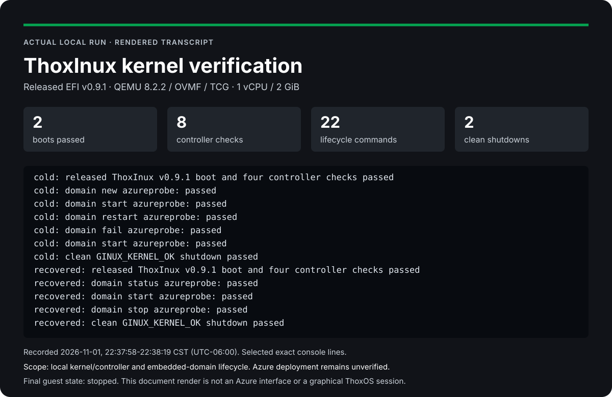

# ThoxInux on Azure

Your AI. Your Data. Your Rules.™

[](LICENSE)
[](https://github.com/Thox-ai/thoxinux-azure/releases)
[](https://github.com/Thox-ai/thoxinux-azure/actions/workflows/verify.yml)
[](https://github.com/Thox-ai/thoxinux-azure/commits/main)
[](https://thox.ai)
[](docs/ARCHITECTURE.md)
[](https://github.com/Thox-ai/thoxinux/releases/tag/v0.9.1)

Deploy an Azure VM that runs the real **ThoxInux kernel, the ThoxOS Core**, continuously inside an unprivileged QEMU guest. The deployment creates its infrastructure, installs the pinned release, starts the service, and checks the kernel before reporting success.

[](https://portal.azure.com/#create/Microsoft.Template/uri/https%3A%2F%2Fraw.githubusercontent.com%2FThox-ai%2Fthoxinux-azure%2Fmain%2Fportal%2Fazuredeploy.json)

The button loads this repository's public `main/portal/azuredeploy.json` into Azure's deployment form. Source publication must complete before that URL is available. For first publication or distribution to another repository, see the [publishing guide](docs/PUBLISH.md).

**Engineering preview.** The real kernel has passed local boot, controller, lifecycle, recovery and clean-shutdown checks. Live Azure ARM validation, provisioning, cloud-init and systemd acceptance have not yet been recorded. A valid deployment button and local tests do not establish a successful Azure deployment. See [validation and limits](docs/VALIDATION.md).

## Preview and release status



This is a rendering of the recorded local verifier output, not an Azure portal screenshot. The [complete preview](docs/PREVIEW.md) includes the [self-contained HTML](docs/PREVIEW.html), [two-page PDF](docs/PREVIEW.pdf), raw evidence, exact hashes and reproduction commands. No simulated desktop or full userspace is presented as working.

The **integration release** badge tracks this deployment repository, including prereleases. The **kernel** badge identifies the separate upstream ThoxInux v0.9.1 payload. CI and last-commit badges read GitHub's actual state; unavailable or pending results must not be treated as passing.

The first intended integration version is **v0.1.0-rc.1**, an engineering preview. The [release workflow](.github/workflows/verify.yml) runs verification before a separate release job can publish a formal GitHub prerelease. A version file alone is not a published release. Use the [Releases page](https://github.com/Thox-ai/thoxinux-azure/releases) and its attached evidence for the actual publication state.

## Deploy

1. Select **Deploy to Azure** and sign in to the intended subscription.
2. For **Resource group**, select **Create new**. Use a dedicated name such as `rg-thoxinux-kernel-demo`.
3. Select a region with Dsv5 quota. Keep `Standard_D2s_v5` and the generated VM name unless you need to change them.
4. Paste an OpenSSH **public key**, then select **Review + create**, review the resources and charges, and select **Create**.
5. After deployment succeeds, open the VM's **Run command → RunShellScript** and run:

```bash
/usr/local/bin/thox-kernel status
```

Require `accepted: true`, `running: true`, and `checks_passed: 4`. The deployment's Custom Script extension waits for cloud-init, an active service and this same status check. Check again when you need current health; an old deployment result is not a live health monitor.

No SSH port is opened. The public key satisfies Azure's administrator configuration. [Quick start](docs/QUICKSTART.md) explains how to obtain a key and resolve common deployment issues.

## What Azure creates

| Resource | Default configuration |
| --- | --- |
| VM | Ubuntu 24.04 AMD64, Generation 2, `Standard_D2s_v5` |
| Host capacity | 2 vCPUs, 8 GiB RAM; optional D4s_v5 has 4 vCPUs and 16 GiB |
| Managed OS disk | 128 GiB Standard SSD |
| Virtual network and subnet | Dedicated network; implicit default outbound access disabled |
| Network security group | All inbound traffic denied |
| NIC and public IP | Accelerated networking; Standard static IPv4 for explicit outbound access |
| Host boot protection | Trusted Launch, Secure Boot and vTPM |
| Guest service | Locked `thoxinux` account; QEMU TCG, Q35/OVMF, 1 vCPU and 2 GiB RAM |
| Guest storage | Sparse 64 GiB persistent volume on the host OS disk |
| Acceptance extension | Fails the deployment if initialization or kernel acceptance fails |
| Management | Azure VM agent and Run Command |

Ubuntu supplies Azure's Hyper-V drivers and management agent. ThoxInux runs as its own kernel inside QEMU. The guest uses a separate unsigned OVMF boot environment. This package does not claim that ThoxInux boots directly on Azure Hyper-V. The validated guest stays at 2 GiB because of the current EFI mapping limit.

The VM, managed disk and public IPv4 incur Azure charges. No NAT Gateway, Bastion, load balancer, GPU or paid application service is created. Use **Stop** and confirm **Stopped (deallocated)** to stop compute billing; the retained disk and public IP remain billable.

## Use the running kernel

Run these from **Run command → RunShellScript** on the Azure VM:

```bash
runuser -u thoxinux -- /usr/local/bin/thox-kernel command status
runuser -u thoxinux -- /usr/local/bin/thox-kernel command components
runuser -u thoxinux -- /usr/local/bin/thox-kernel command domain list
/usr/local/bin/thox-kernel logs --lines 30
```

Commands go through an owner-only Unix socket to the actual kernel controller. The service verifies the EFI identity, boot banner and four controller responses. Current status also checks process identity, process start times and a fresh heartbeat.

The kernel is an engineering preview. Its embedded domain controller works in the recorded tests, but domain `Rootfs: pending` remains. A ready Linux userspace, desktop, arbitrary application workload, MeshStack and ThoxWork integration are outside the demonstrated scope. See the [user guide](docs/USER_GUIDE.md).

## Source and release identity

| Item | Pin |
| --- | --- |
| Kernel release | [ThoxInux v0.9.1](https://github.com/Thox-ai/thoxinux/releases/tag/v0.9.1) |
| Canonical source | `fbad5952f20281ef6ad7eaefc1f54f7db4c0c6e9` |
| Preserved Ginux upstream | `36503bda2d87465765e1b94e65f9d100f27ed5be` |
| EFI size | 12,507,648 bytes |
| EFI SHA-256 | `1bc1c7af33470edc009fa5756d3fe6063573660e07e157d19397afc680a7bb89` |

The kernel, release receipt, manifest, launcher and upstream notices are checked by exact hash before boot. The v0.9.1 release does not change the kernel code's displayed `ThoxInux 0.9.0` banner. The released receipt also retains older metadata labels. These original bytes are preserved; the EFI hash binds the actual release used here.

The portal resolves Ubuntu's regional `latest` image at deployment and records its exact version in the deployment outputs. The [CLI deployment](docs/CLI_DEPLOYMENT.md) instead resolves and freezes the exact host image before deployment and adds resource ownership and what-if guards.

## Verify or develop

```bash
python3 -B -m unittest discover -s tests -v
python3 build_cloud_init.py --check
python3 portal/build_portal.py --check
```

On a Linux workstation with Python 3.11+, QEMU, OVMF and util-linux, run as an ordinary user:

```bash
python3 tools/verify_kernel.py --output /tmp/thoxinux-kernel-proof
```

The output directory must be new. This boots the pinned real kernel twice and preserves evidence for eight controller checks, 22 domain lifecycle checks, persistent-state recovery and two clean shutdowns. It does not install a host service or provision Azure. The GitHub Actions workflow performs these same checks when enabled in the published repository.

## Release contents and upgrades

A verified integration prerelease includes the public source ZIP, its complete manifest and checksum, plus evidence produced by the actual CI kernel run. Release notes record changes, validation, limits and upgrade guidance. Existing tags and published assets are not overwritten. [RELEASE_NOTES.md](RELEASE_NOTES.md) describes the initial candidate and [the publishing guide](docs/PUBLISH.md) explains the gate.

This initial release has no supported in-place upgrade procedure. For a changed kernel, host profile or bootstrap, create a new dedicated resource group and verify it before retiring the old environment. Preserve required guest data first. An existing CLI plan remains bound to its original files and parameters.

## Documentation

- [Runtime preview: HTML, PDF and actual evidence](docs/PREVIEW.md)
- [Quick start](docs/QUICKSTART.md)
- [User guide and troubleshooting](docs/USER_GUIDE.md)
- [Portal template details](portal/README.md)
- [CLI deployment and immutable plans](docs/CLI_DEPLOYMENT.md)
- [Architecture and security boundaries](docs/ARCHITECTURE.md)
- [Validation evidence and remaining acceptance](docs/VALIDATION.md)
- [Development](docs/DEVELOPMENT.md)
- [Publish the repository and release](docs/PUBLISH.md)
- [Public repository requirements and evidence](docs/REPOSITORY_STANDARD.md)
- [Reproducible source packaging](docs/PACKAGING.md)

## License and governance

Copyright © 2026 THOX.ai LLC. This deployment integration is licensed under [Apache-2.0](LICENSE). Preserve [NOTICE](NOTICE), [upstream attribution](UPSTREAM-NOTICE.md), `payload/GINUX_LICENSE` and `payload/GINUX_NOTICE`. The latter files are hash-bound to the upstream release. MeshStack, ThoxKey firmware and ThoxWork are separate proprietary THOX technologies and are not included or licensed by this repository.

Deployment readiness, local kernel acceptance and live Azure acceptance are tracked separately. Public documentation must describe actual evidence and must not imply provider certification or full operating-system readiness. Changes follow [CONTRIBUTING.md](CONTRIBUTING.md) and [SECURITY.md](SECURITY.md).
