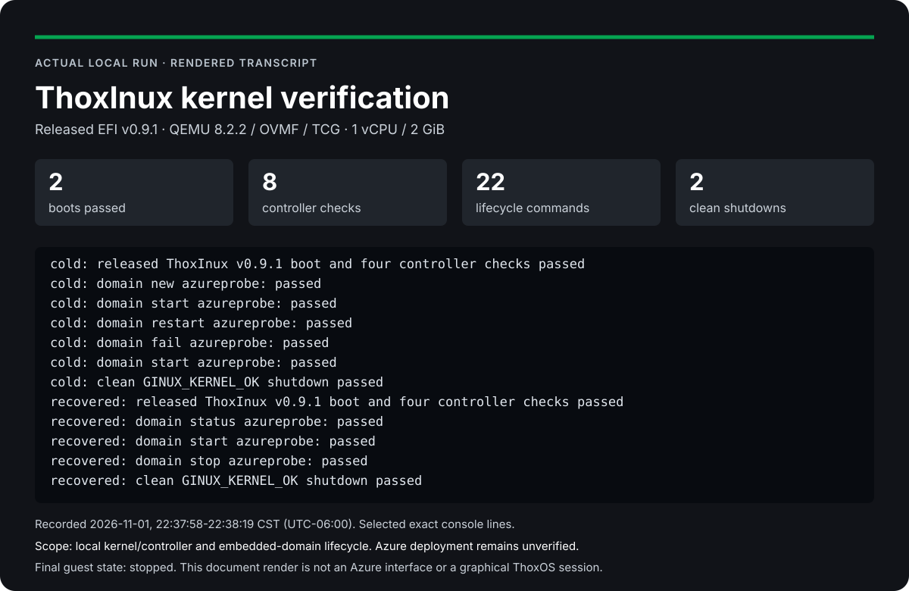

# Recorded kernel preview

This preview renders the **actual local QEMU run recorded on 2026-11-01, 22:37:58-22:38:19 CST (UTC-06:00)**.
The released ThoxInux **v0.9.1** EFI passed two boots, eight controller checks,
22 embedded-domain lifecycle commands and two clean shutdowns. Both guests
were stopped when the test ended. These results are recorded in
[summary.json](../validation/portable-qemu/summary.json).



## Read the complete preview

- [Standalone HTML](PREVIEW.html): readable report with the complete 26-line harness sequence, source links and reproduction steps. Download and open locally; GitHub shows HTML source.
- [Two-page PDF](PREVIEW.pdf): portable report with the same recorded sequence, exact hashes and evidence boundaries.
- [Complete harness console](../validation/portable-qemu/harness-console.log), [raw serial log](../validation/portable-qemu/serial.log) and [readback verification](../validation/portable-qemu/readback-validation.json).

The SVG is a rendered excerpt of exact console lines. The HTML and PDF show all
26 harness progress lines, before the JSON summary. Display wrapping and line
selection do not change the original evidence. These are document previews of
a headless run; no Azure UI, desktop or live terminal session is pictured.

## Reproduce the real test

On a Linux host with Python 3.11 or newer, run from the repository root:

```bash
sudo apt-get update
sudo apt-get install --yes qemu-system-x86 ovmf util-linux
python3 tools/verify_kernel.py --output /tmp/thoxinux-proof-01
```

Run the verifier as an ordinary user and choose a new output path. It verifies
the pinned release assets, uses the unmodified upstream launcher, records two
actual QEMU boots and cleans up its temporary guest processes. Read the saved
`summary.json`, lifecycle results, receipts, serial output and supervisor logs.
This command produces new execution evidence; reading this preview does not run
the guest.

## Exact source identity

| Record | Value |
| --- | --- |
| Kernel release | [v0.9.1](https://github.com/Thox-ai/thoxinux/releases/tag/v0.9.1) |
| Actual kernel banner | `ThoxInux 0.9.0` |
| Source commit | `fbad5952f20281ef6ad7eaefc1f54f7db4c0c6e9` |
| EFI SHA-256 | `1bc1c7af33470edc009fa5756d3fe6063573660e07e157d19397afc680a7bb89` |
| Serial-log SHA-256 | `8e6fa0f40e9b02809132df99ca0363e43fc0aba83e7dbc41020220c3d5256ba9` |
| Harness-console SHA-256 | `5155517e3ad42f135c413f1b5292c7b05f5e7861d3371f4f31b0752ed7ab4d4b` |
| Tested verifier SHA-256 | `3825e4808a406c243ecbd8b3b2f85eefa0956edc34a84c0cb5720ef83e8fee71` |
| Profile | Q35 / OVMF / 1 vCPU / 2 GiB / TCG / 48-bit IOMMU |
| Raw UTC start / end | `2026-11-02T04:37:58+00:00` / `2026-11-02T04:38:19+00:00` |

## Scope and document provenance

Actual local QEMU execution of the released kernel and embedded-domain lifecycle. Azure deployment, production service, native Hyper-V, a graphical desktop and MeshStack were not tested. Rootfs pending does not establish ready Rocky Linux or systemd userspace.

The deployment package version in [VERSION](../VERSION) is independent of the
kernel release and banner. Follow [Quickstart](QUICKSTART.md) for deployment;
Azure acceptance requires the actual host's live service and guest evidence.

The HTML uses the verified THOX document template 1.0.0 snapshot dated
2026-10-05. It preserves the original outlined corporate identity and uses the
approved `#05A451` primary accent. Its text uses Inter when installed, with
system sans-serif fallbacks; technical text uses installed JetBrains Mono or
system monospace fallbacks. The HTML carries no raw or base64 font files and
does not download fonts. The logo SVG SHA-256 is
`a3976ea8482509a01ba2da1727122dd721487f921c72986369f1756449a37673`;
the PDF uses its canonical PNG counterpart,
`6e2b7309c32b0d09f294a0be3f558014798fd569a96c00ccc15281595b22aa03`.
The PDF retains normal document font subsets of Inter Regular/Bold and
JetBrains Mono Regular. Those embedded subsets preserve selectable text and
portable document rendering; separate font files are not distributed in the
source package. Inter and JetBrains Mono attribution is retained in
[NOTICE](../NOTICE), with their OFL text also retained as HTML source comments.
The HTML contains no scripts, tracking, forms or automatic external resources.
Its ordinary source links navigate only when selected.

The preview is a publication of recorded engineering evidence, not a new
kernel run or an Azure verification receipt. Raw test files remain unchanged.
